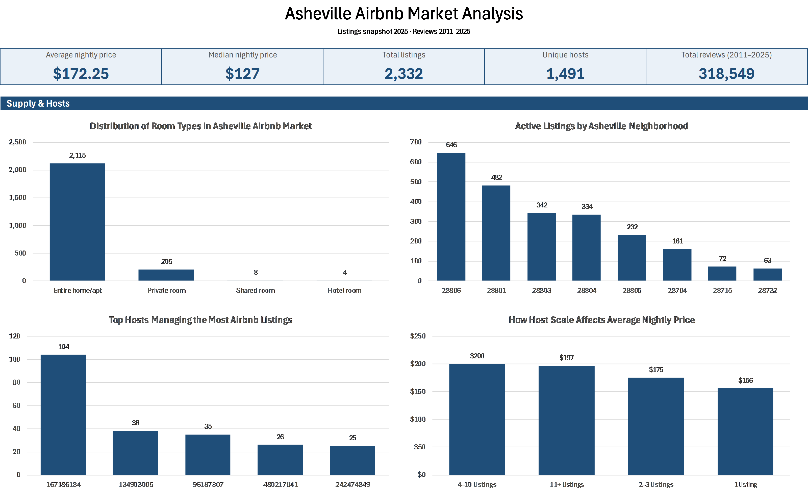
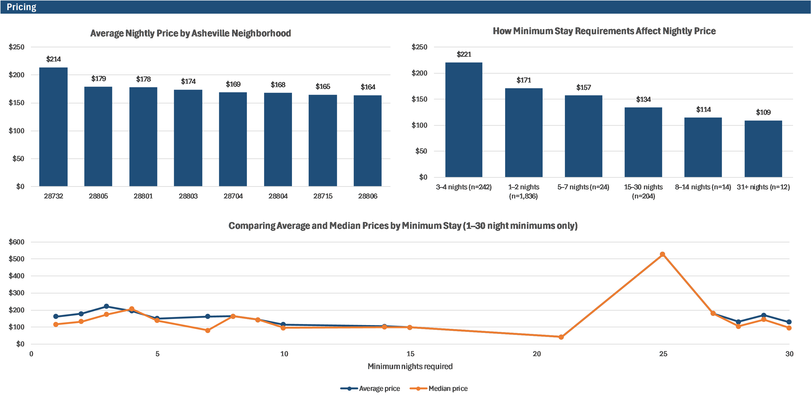
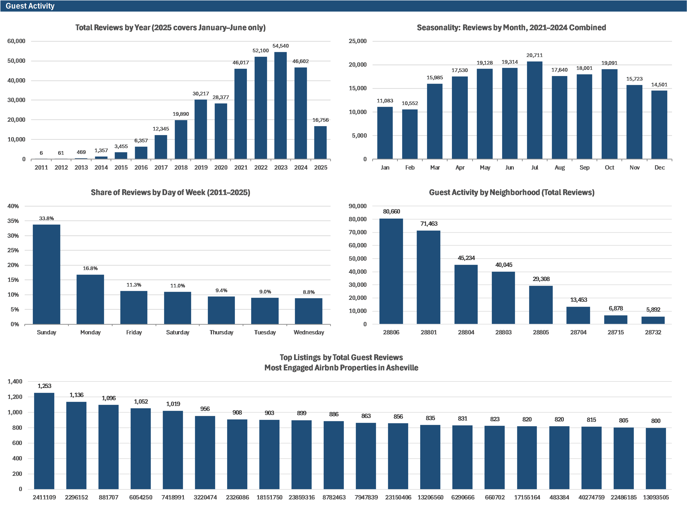

# 🏡 Asheville Airbnb Listings Analysis
**Tools Used:** SQL (MySQL) · Excel · Python (for cleaning)

---

## 📘 Introduction
This project analyzes **Airbnb listings in Asheville, North Carolina**, to uncover patterns in **pricing**, **host activity**, and **guest demand**.
Using MySQL, Excel, and a small Python script, the analysis looks at listing details alongside review activity to understand what drives Airbnb performance across neighborhoods (ZIP codes).

The dataset comes from **Analyst Builder's Airbnb Market Case Study**. Queries were written in **MySQL Workbench**, visuals were built with **Excel PivotTables**, and **Python** was used to fix a character encoding problem that blocked the MySQL import.

---

## 🗃️ Dataset

| File | Rows | Contents |
|------|------|----------|
| `listings.csv` | 2,876 | One row per listing: host, ZIP code, room type, price, minimum nights, review counts, availability |
| `reviews.csv` | 318,549 | One row per review: `listing_id` and `date` only (no review text), from July 2011 to June 2025 |
| `neighbourhoods.csv` | 8 | The 8 Asheville-area ZIP codes used as neighborhoods |

The listings file is a single snapshot, and the reviews file ends in **June 2025**, so 2025 is a partial year.

---

## 📈 Key Insights Summary

| Metric | Value | Insight |
|--------|--------|----------|
| **Average Nightly Price** | **$172.25** | Median price is $127.00, showing a right skew from premium listings. |
| **Most Expensive Neighborhood** | **28732 ($213.95 avg)** | Highest prices but the fewest listings (63). |
| **Cheapest Neighborhood** | **28806 ($163.99 avg)** | Most competitive ZIP code, with 646 listings. |
| **Dominant Room Type** | **Entire home/apartment (90.7%)** | Reflects Asheville's preference for private stays. |
| **Top Host Portfolio** | **104 listings (Host ID 167186184)** | A few large hosts control a noticeable share of supply. |
| **Peak Guest Activity** | **Late spring through summer** | In full years (2021 to 2024), reviews are highest from May to July; January and February are the slowest months. |
| **Top ZIPs for Demand** | **28806, 28801, 28804** | These areas collect the most guest reviews. |

---

## 📊 Excel Dashboard

Screenshots from `Analysis/excel/Asheville Airbnb Dashboard.xlsx`.

**Supply and hosts:** room type distribution, active listings by neighborhood, top hosts, and host scale vs. price.

**Pricing:** average price by neighborhood, minimum stay vs. price, and average vs. median price by minimum stay.

**Guest activity:** total reviews by year, reviews by month (2021 to 2024), share of reviews by weekday, total reviews by neighborhood, and the most-reviewed listings.

> Note: the yearly, monthly, and weekday review charts come from `review_history.sql` and count individual reviews. The 2025 bar covers January to June only.

---

## 🎯 Objectives
The main goals of this analysis are:

1. To explore the distribution and characteristics of Airbnb listings across Asheville.
2. To examine **pricing trends** by neighborhood and minimum stay requirements.
3. To analyze **host behavior** and market concentration.
4. To uncover **guest demand patterns** using review data.
5. To provide **recommendations** for hosts, investors, and tourism marketers.

---

## 🧰 Tools Used

### 🧮 SQL (MySQL Workbench)
Used for querying, aggregating, and transforming the data.
Key techniques: **CTEs**, **window functions** (`ROW_NUMBER`, `DENSE_RANK`, `COUNT() OVER`), **views**, **CASE bucketing**, and **date parsing**.

### 📊 Excel
Used for data exploration, **PivotTables**, and building the **dashboard** summarizing pricing, host activity, and reviews.

### 🐍 Python
Used for one cleaning step: `CleaningCharacters.py` uses Python's built-in `re` module to strip characters that MySQL could not import (see below). No external libraries are required.

---

## 🧹 Data Cleaning

Steps taken to go from `listings.csv` (2,876 rows) to `Listing-Analysis-Clean2.csv` (2,332 rows):

- **Dropped unused columns:** `neighbourhood_group` and `license` were empty for every listing.
- **Removed listings with no price** (340 rows), since they can't be used in pricing analysis.
- **Removed listings with no reviews** (no `last_review` or `reviews_per_month`), leaving only listings with guest activity.
- **Checked for duplicate rows:** none found.
- **Removed special characters** from text fields so the file could be imported into MySQL (`Clean1` → `Clean2`).
- **Parsed dates in SQL:** `last_review` is stored as `M/D/YYYY` text and converted with `STR_TO_DATE` inside the queries.

Outliers were **kept** (for example, one listing at $2,043/night and minimum stays up to 730 nights). This is why the median is reported alongside the average.

---

## ⚠️ Problems Faced and Solutions

### Problem:
The cleaned `listings.csv` file **could not be loaded into MySQL Workbench** because some text fields (listing names, host names) contained **emojis and other special characters**.

### Diagnosis:
MySQL threw an encoding error ("incorrect string value") when reading the file, preventing full table creation.

### Solution:
A **Python script** (`CleaningCharacters.py`) reads the file line by line and uses a regular expression to remove every character outside the standard printable ASCII range, then saves the result as `Listing-Analysis-Clean2.csv`.

### Outcome:
- The cleaned dataset imported **without errors**.
- All numeric fields were unaffected.
- **Trade-off:** emojis and accented letters (for example, "é") were removed from listing and host names. This doesn't affect any analysis here, since none of it uses those text fields.

---

## 🧾 SQL Analysis Overview

Results in `/SQL/results/` come from two files:
- **`combined_clean_version.sql`**: listing-level analysis (pricing, supply, hosts, review totals), built on the cleaned listings table.
- **`review_history.sql`**: review-level analysis (reviews by year, month, and weekday), built on `reviews.csv`.

The other `.sql` files are earlier drafts of individual questions.

| Category | Question | Insight |
|-----------|------------|----------|
| **Pricing** | Average price by neighborhood | Average nightly price ranges from **$164 to $214**; ZIP `28732` is highest. |
|  | Minimum nights vs. average price | 3 to 4 night minimums have the highest average price ($221); prices mostly fall as minimum stays get longer. |
|  | Overall average and median price | Mean ($172) > Median ($127), confirming right-skewed pricing. |
| **Supply** | Active listings per neighborhood | ZIP `28806` has **646 listings**, the most in Asheville. |
|  | Distribution of room types | **Entire home/apartment = 90.7%**, **Private room = 8.8%**, others <1%. |
| **Hosts** | Hosts with the most listings | About 96% of hosts manage 3 or fewer listings; one host manages 104. |
|  | Do multi-listing hosts charge more? | Yes. Listings from hosts with 4+ listings average about $198 per night, versus about $156 for single-listing hosts. |
| **Demand** | Total reviews per listing | The most-reviewed listing has **1,253 total reviews**. |
|  | Total reviews by neighborhood | ZIPs `28806`, `28801`, and `28804` have the most guest reviews. |
|  | Reviews by year (`review_history.sql`) | Yearly reviews grew from 2020 to a peak in 2023, then dipped slightly in 2024. |
|  | Reviews by month, 2021 to 2024 (`review_history.sql`) | Reviews peak from May to July; January and February are the slowest months. |
|  | Reviews by weekday (`review_history.sql`) | Sundays account for 33.8% of all reviews. |

---

## 📊 Key Findings

### 🏠 Market Composition
- **Entire homes/apartments** dominate (90.7%), followed by **private rooms (8.8%)**.
- ZIPs **28806 and 28801** lead in both listings and guest reviews, followed by 28803 (listings) and 28804 (reviews).

### 💰 Pricing Trends
- **Average price:** $172 | **Median:** $127 → right-skewed distribution.
- **3 to 4 night minimum stays** are priced highest ($221), ahead of 1 to 2 night stays ($171), which make up most listings (1,836).
- **Long-term stays (31+ nights)** average around $109, though only 12 listings fall in this group.
- **ZIP 28732** has the **highest average price ($213.95)**; **28806** has the lowest average ($163.99) and the most listings.

### 👥 Host Behavior
- **Most hosts are small:** about 96% manage 1 to 3 listings.
- **Outlier host:** one host manages **104 listings**, showing some market concentration.
- **Larger hosts charge more:** listings from hosts with 4+ properties average about $198 per night, versus about $156 for single-listing hosts, suggesting professional operators run larger or more premium properties.

### 💬 Demand & Reviews
- Yearly review counts **peaked in 2023** (about 54,500 reviews) after growing each year from 2020.
- **Seasonality:** in full years (2021 to 2024), review activity is strongest from **May through July**, stays high into the fall, and drops to its lowest in **January and February**.
- **Sundays** account for **about 33.8% of reviews**, most likely because guests review after weekend checkouts.
- ZIPs **28806, 28801, and 28804** generate the most guest reviews.

> Note: review counts are a stand-in for demand. Not every guest leaves a review, so they show relative activity, not actual bookings.

---

## 💬 Conclusion and Insights

The Asheville Airbnb market is **active, competitive, and seasonal**.
Most properties are **entire homes**, suggesting travelers prefer private stays, and while most hosts are small, **a few large hosts manage a notable share of supply**.

**Key takeaways:**
- **28806** offers opportunity for budget-conscious travelers and competitive hosts.
- **28732** and **28801** cater to higher-end travelers seeking premium stays.
- **Short minimum stays (under a week)** have the highest nightly rates, so flexible minimums appear to support stronger pricing.
- **Demand patterns** follow Asheville's tourism calendar: strong spring and summer, slow winters.

**Strategic Recommendation:**
Hosts and investors should focus on **ZIPs 28806, 28801, and 28804**, keep **1 to 4 night minimum stays**, and plan pricing and promotions around the **May to July peak**, using the slow **January and February** months for discounts or maintenance.

---

## 🚧 Limitations
- **Reviews are not bookings.** Demand is measured with review counts, which undercount actual stays.
- **2025 is a partial year** (data ends in June), so it is excluded from seasonal comparisons.
- **Some listing IDs lost precision.** Very long listing IDs are stored in scientific notation in the source data (including `Data/Raw/listings.csv`), so a few different listings share the same rounded ID. Because of this, the queries count listing rows instead of distinct IDs.
- **Outliers were not removed**, which pulls averages up; medians are shown where it matters.

---

## 🔍 Opportunities for Further Analysis
Future extensions could include:
- 🧠 **Predictive modeling** for price or occupancy based on location and host metrics.
- 🌎 **Geospatial analysis** using the latitude and longitude columns to map price clusters.
- 💬 **Sentiment analysis** on review text (this would require the full reviews dataset, since `reviews.csv` only includes dates).
- ⭐ **Host performance** evaluation (for example, Superhost status or response time) with a more detailed listings file.

---

## ▶️ How to Reproduce
1. Run `Data/Cleaned/CleaningCharacters.py` to create `Listing-Analysis-Clean2.csv` from `Listing-Analysis-Clean1.csv`.
2. In MySQL Workbench, create a schema named `ashevilleairbnbanalysis` and import `Listing-Analysis-Clean2.csv` as a table named `listing-analysis-clean2` (Table Data Import Wizard). The table should have **2,332 rows**. The import wizard can skip the 4 listings whose names start with a double quote; if your table has 2,328 rows, run `SQL/queries/insert_missing_listings.sql` to add them.
3. Run `SQL/queries/combined_clean_version.sql` to create the listing analysis views.
4. Import `Data/Raw/reviews.csv` as a table named `reviews` (columns `listing_id`, `review_date`), then run `SQL/queries/review_history.sql` to create the review history views. The file also includes an optional `LOAD DATA` statement for importing the CSV directly.
5. Query the views (for example, `SELECT * FROM avg_price_by_neighborhood;` or `SELECT * FROM reviews_by_weekday;`) and export results to CSV for Excel.

> Note: the `avg_reviews_per_month` view in `combined_clean_version.sql` measures something different from the review history views. It averages each listing's `reviews_per_month` value, grouped by the month of that listing's most recent review. The yearly, monthly, and weekday review findings come from `review_history.sql`.

---

## 🗂️ Project Deliverables

| Category | File | Description |
|-----------|------|-------------|
| **Data** | `/Data/Raw/` | Original Airbnb datasets (`listings.csv`, `reviews.csv`, `neighbourhoods.csv`). |
|  | `/Data/Cleaned/Listing-Analysis-Clean1.csv` | Listings after removing unused columns and rows with no price or reviews. |
|  | `/Data/Cleaned/Listing-Analysis-Clean2.csv` | Final cleaned listings file used in MySQL. |
|  | `/Data/Cleaned/CleaningCharacters.py` | Script that removes special characters for the MySQL import. |
| **SQL** | `/SQL/queries/combined_clean_version.sql` | Final listing queries, organized as views. |
|  | `/SQL/queries/review_history.sql` | Review history queries (by year, month, and weekday) built on `reviews.csv`. |
|  | `/SQL/queries/insert_missing_listings.sql` | Adds the 4 listings that the import wizard can skip (names starting with a double quote). |
|  | `/SQL/queries/` (other files) | Earlier drafts of individual queries. |
|  | `/SQL/results/` | Query results in CSV format, used for the Excel visuals. |
| **Analysis** | `/Analysis/excel/Asheville Airbnb Dashboard.xlsx` | Excel dashboard with KPI cards, PivotTables, and charts summarizing the findings. |
|  | `/images/` | Dashboard screenshots shown in this README. |
| **Documentation** | `README.md` | Project overview, findings, and structure. |

---

## 🧾 Credit
Dataset and analytical framework adapted from **Analyst Builder's Airbnb Market Case Study**.
All SQL, Excel, and reporting developed by *Nii Oye Kpakpo* (2025).
